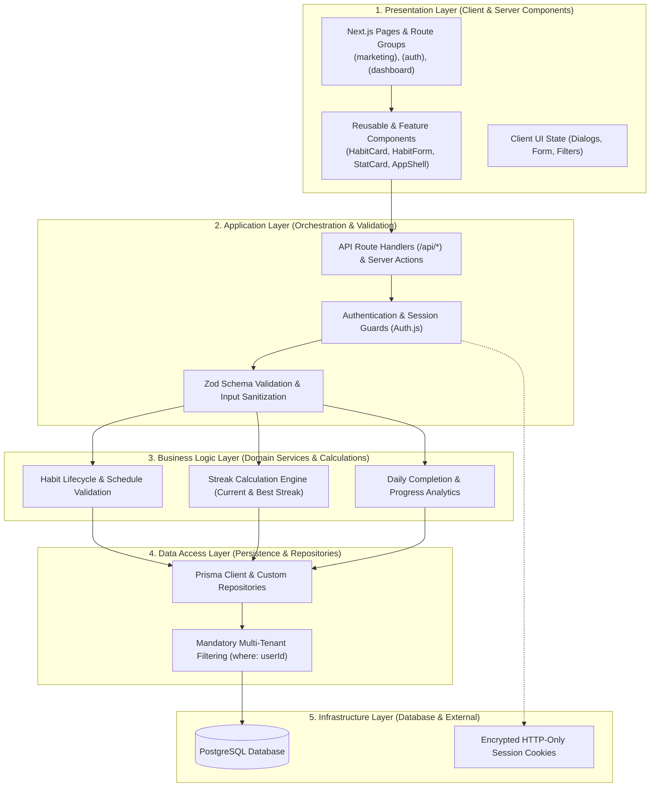
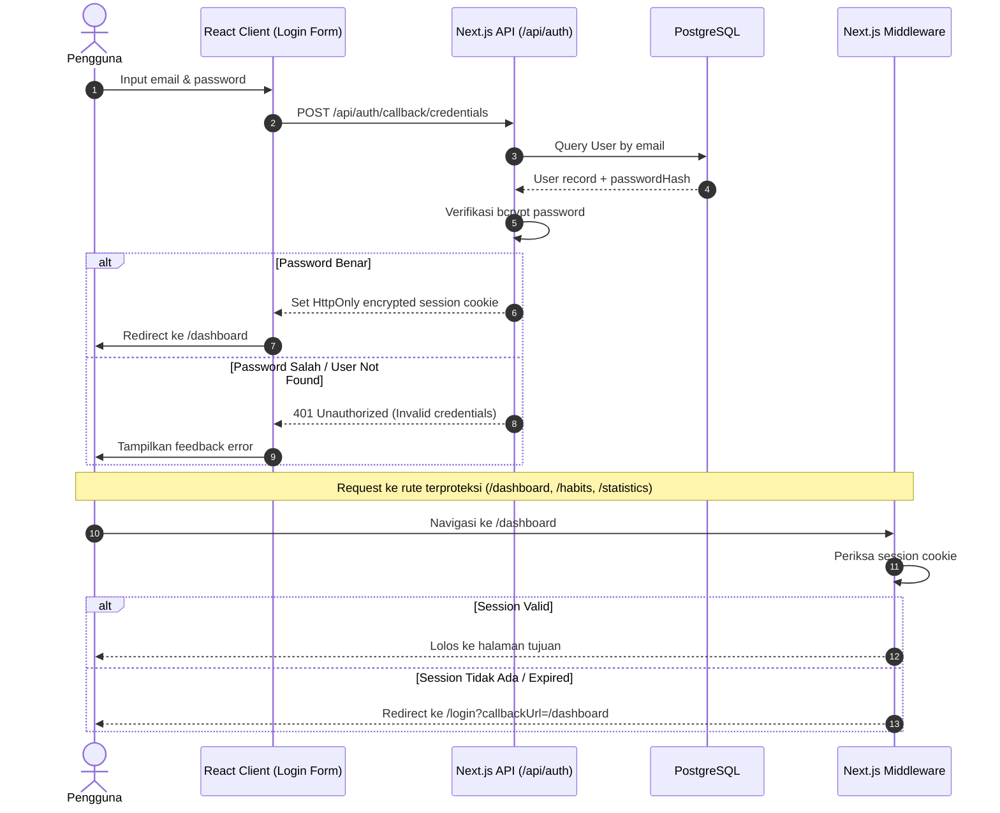
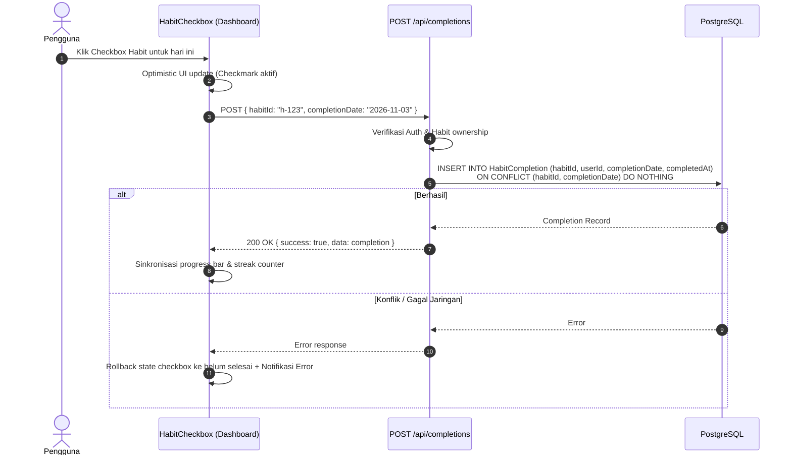

# TECHNICAL PLAN — HABIT TRACKER

**Dokumen Referensi Utama**: [PRD and Playbook.md](./PRD%20and%20Playbook.md)  
**Versi**: 1.0.0  
**Status**: Approved (Phase 2 Deliverable)  
**Tanggal**: 2026-11-03  
**Penulis**: Senior Software Architect / Solo Fullstack Developer  

---

## 1. Executive Summary & Architectural Decisions

Habit Tracker dibangun sebagai aplikasi web **Modular Monolith** modern menggunakan **Next.js App Router** berbasis **TypeScript**. Seluruh arsitektur memprioritaskan prinsip kesederhanaan, keterbacaan kode (*clean and pragmatic architecture*), keandalan persistensi data pengguna, dan pemenuhan ruang lingkup MVP tanpa *over-engineering*.

### Ringkasan Keputusan Teknis Utama:

| Komponen | Keputusan | Rasionalisasi & Batasan |
| :--- | :--- | :--- |
| **Arsitektur Utama** | Next.js Modular Monolith | Menghindari kompleksitas jaringan & deployment microservices; backend dan frontend terintegrasi dalam satu codebase yang kohesif. |
| **Frontend Framework** | Next.js 15+ (App Router) | React Server Components (RSC) untuk efisiensi streaming data dan SEO landing page; Client Components untuk interaktivitas instan dashboard. |
| **Styling & UI Kit** | Tailwind CSS v4 + shadcn/ui | Komponen headless berbasis Radix UI yang dapat disesuaikan tanpa runtime CSS overhead, accessible (WAI-ARIA), responsif desktop-ke-mobile. |
| **Database Engine** | PostgreSQL | Relational database tangguh dengan dukungan integritas foreign keys, unique composite constraints, indexing performan, dan kemudahan migrasi. |
| **ORM** | Prisma ORM | Type-safe database client, declarative schema modeling, automated migrations, serta integrasi mulus dengan TypeScript. |
| **Autentikasi** | Auth.js (NextAuth v5) | Solusi autentikasi standar industri Next.js dengan dukungan session berbasis JWT/secure cookies dan Prisma Adapter. |
| **Validasi Skema** | Zod | *Single source of truth* untuk validasi data runtime baik di client (form input) maupun di server (API routes & server actions). |
| **State Management** | React State (Local) + Server Source of Truth | Mengutamakan database sebagai *single source of truth*; local React state (`useState`, `useReducer`) untuk UI modal/form. Zustand hanya digunakan jika terdapat client-state lintas modul yang kompleks. |

---

## 2. Technical Architecture & Layered System

Aplikasi mengadopsi pemisahan lapisan tanggung jawab (*Separation of Concerns*) yang pragmatis dengan 5 lapisan hierarki:



### Rincian Tanggung Jawab Lapisan:
1. **Presentation Layer (`src/components/`, `src/app/`)**: Hanya bertanggung jawab menangani rendering visual, feedback interaksi pengguna, aksesibilitas keyboard, dan state visual lokal (misal: modal terbuka/tertutup). Tidak ada kalkulasi bisnis database di komponen.
2. **Application Layer (`src/app/api/`, `src/features/*/actions.ts`)**: Menerima request HTTP/Action, memvalidasi identitas user melalui sesi autentikasi, memvalidasi format input via Zod, dan meneruskannya ke domain service.
3. **Business Logic Layer (`src/services/`, `src/features/*/services/`)**: Inti logika bisnis murni. Menghitung streak, validasi jadwal kebiasaan harian, rasio keberhasilan (*completion rate*), dan manipulasi status tanpa ketergantungan langsung pada framework web.
4. **Data Access Layer (`src/lib/db/`, `src/services/repositories/`)**: Melakukan kueri Prisma ORM yang terisolasi. Mewajibkan klausul `where: { userId: session.userId }` pada setiap kueri habit untuk mencegah *IDOR (Insecure Direct Object References)*.
5. **Infrastructure Layer**: Penyedia persistensi PostgreSQL, penyimpanan session cookie yang aman (`HttpOnly`, `SameSite=Lax`, `Secure`), dan environment variables.

---

## 3. Detailed Folder Structure

Struktur folder dirancang modular, memisahkan komponen generik (*reusable*) dari fitur spesifik domain (*feature-driven*):

```text
habit-tracker/
├── prisma/
│   ├── schema.prisma               # Definisi skema database Prisma & relasi
│   ├── migrations/                 # Catatan migrasi database SQL
│   └── seed.ts                     # Script seed untuk development testing
├── public/                         # Aset publik statis (logo, favicon, icons)
├── src/
│   ├── app/                        # Next.js App Router (Routing & Pages)
│   │   ├── (marketing)/            # Public landing group
│   │   │   ├── page.tsx            # Landing page publik (Hero, Value Prop)
│   │   │   └── layout.tsx          # Layout landing page
│   │   ├── (auth)/                 # Authentication route group
│   │   │   ├── login/
│   │   │   │   └── page.tsx        # Halaman Login
│   │   │   ├── register/
│   │   │   │   └── page.tsx        # Halaman Registrasi
│   │   │   └── layout.tsx          # Auth layout (centered card container)
│   │   ├── (dashboard)/            # Authenticated application group
│   │   │   ├── dashboard/
│   │   │   │   └── page.tsx        # Daily Overview (Today's Habits & Progress)
│   │   │   ├── habits/
│   │   │   │   ├── page.tsx        # Habit Management List
│   │   │   │   ├── new/
│   │   │   │   │   └── page.tsx    # Create Habit Page / Form
│   │   │   │   └── [id]/
│   │   │   │       └── edit/
│   │   │   │           └── page.tsx# Edit Habit Page
│   │   │   ├── statistics/
│   │   │   │   └── page.tsx        # Habit History & Basic Analytics
│   │   │   ├── settings/
│   │   │   │   └── page.tsx        # Account Settings & Profile
│   │   │   └── layout.tsx          # Authenticated AppShell (Sidebar & Header)
│   │   ├── api/                    # Route Handlers (REST Endpoints)
│   │   │   ├── auth/
│   │   │   │   └── [...nextauth]/
│   │   │   │       └── route.ts    # Auth.js handler endpoint
│   │   │   ├── habits/
│   │   │   │   ├── route.ts        # GET /api/habits, POST /api/habits
│   │   │   │   └── [id]/
│   │   │   │       └── route.ts    # GET, PATCH, DELETE /api/habits/:id
│   │   │   ├── completions/
│   │   │   │   ├── route.ts        # GET, POST /api/completions (Toggle/Create)
│   │   │   │   └── [id]/
│   │   │   │       └── route.ts    # DELETE /api/completions/:id (Untrack)
│   │   │   └── statistics/
│   │   │       └── route.ts        # GET /api/statistics (Aggregates & Rates)
│   │   ├── globals.css             # Tailwind v4 theme & CSS custom properties
│   │   └── layout.tsx              # Root HTML & metadata layout
│   │
│   ├── components/                 # Reusable Presentation Components
│   │   ├── ui/                     # Primitif shadcn/ui (Button, Dialog, Card, Input, Label, dll.)
│   │   ├── layout/                 # Komponen kerangka (AppShell, Sidebar, Header, MobileNav)
│   │   ├── feedback/               # LoadingSkeleton, EmptyState, ConfirmDialog
│   │   └── common/                 # DateSelector, ProgressBar, StreakBadge, StatCard
│   │
│   ├── features/                   # Modul per Domain Fitur
│   │   ├── auth/
│   │   │   ├── components/         # LoginForm, RegisterForm
│   │   │   └── schemas.ts          # Zod schema login & register
│   │   ├── habits/
│   │   │   ├── components/         # HabitCard, HabitList, HabitForm, HabitDeleteDialog
│   │   │   └── schemas.ts          # Zod schema create & update habit
│   │   ├── tracking/
│   │   │   ├── components/         # HabitCheckbox, DailyProgressCard, CalendarDayGrid
│   │   │   └── schemas.ts          # Zod schema completion toggle
│   │   └── statistics/
│   │       ├── components/         # CompletionRateChart, StreakSummaryCard, HistoryTable
│   │       └── schemas.ts          # Zod schema filter statistik
│   │
│   ├── lib/                        # Konfigurasi Shared & Singletons
│   │   ├── auth/
│   │   │   ├── auth.ts             # Auth.js konfigurasi (Providers, Callbacks, Handlers)
│   │   │   └── session.ts          # Helper pengambil session user server-side
│   │   ├── db/
│   │   │   └── prisma.ts           # PrismaClient singleton instance
│   │   ├── utils/
│   │   │   ├── date.ts             # Date formatting & timezone calculation (YYYY-MM-DD)
│   │   │   └── styling.ts          # Helper cn() (clsx + tailwind-merge)
│   │   └── validations/            # Schema validasi Zod sentral
│   │
│   ├── services/                   # Business Logic & Data Calculation Engines
│   │   ├── habit.service.ts        # CRUD Habit orchestration & filtering
│   │   ├── tracking.service.ts     # Completion toggle & concurrency handler
│   │   └── streak.service.ts       # Algoritma perhitungan Current & Best Streak
│   │
│   ├── types/                      # Global TypeScript definitions & interfaces
│   │   ├── habit.ts                # Tipe data Habit, Frequency, DTOs
│   │   ├── completion.ts           # Tipe data HabitCompletion
│   │   ├── statistics.ts           # Tipe response ringkasan statistik
│   │   └── next-auth.d.ts          # Module augmentation untuk session user ID
│   │
│   └── constants/                  # Konstanta global (Nav Items, Frequency, Days)
│       ├── navigation.ts           # Daftar menu navigasi & ikon
│       └── days.ts                 # Array konvensi hari (0=Sun .. 6=Sat)
├── .env.example                    # Template variabel lingkungan
├── components.json                 # Konfigurasi shadcn/ui
├── next.config.ts                  # Konfigurasi Next.js
├── tsconfig.json                   # Konfigurasi TypeScript strict mode
└── package.json                    # Dependensi dan script project
```

---

## 4. Data Flow Specifications

### 4.1 Flow Autentikasi & Proteksi Rute


---

### 4.2 Flow Habit CRUD & Multi-Tenant Isolation
Setiap operasi penulisan dan pembacaan habit diwajibkan menyertakan `userId` dari session:
1. **Create Habit**:
   - Client mengirim payload: `{ name, description, frequency, scheduledDays, color }`.
   - Server memvalidasi schema via `createHabitSchema.parse()`.
   - Server menyisipkan `userId: session.user.id` secara otomatis.
   - Database membuat record habit baru.
2. **Read Habits**:
   - Kueri: `prisma.habit.findMany({ where: { userId: session.user.id, isArchived: false } })`.
   - Data user lain tidak mungkin bocor karena klausul `where` terkunci pada `userId`.
3. **Update Habit**:
   - Kueri: `prisma.habit.updateMany({ where: { id: habitId, userId: session.user.id }, data: { ... } })`.
   - Mengembalikan `count: 0` jika habit bukan milik user (diterjemahkan menjadi HTTP 404/403).
4. **Delete Habit**:
   - Soft delete atau hard delete dengan cascade deletion ke `HabitCompletion`:
   - `prisma.habit.deleteMany({ where: { id: habitId, userId: session.user.id } })`.

---

### 4.3 Flow Daily Tracking & Idempotency
Menandai kebiasaan sebagai selesai (*toggle completion*) harus bersifat *idempotent* dan konsisten lintas zona waktu pengguna:



---

### 4.4 Algoritma Perhitungan Streak & Progress

#### 1. Perhitungan Progres Harian (*Daily Progress*):
- Ambil semua habit aktif milik pengguna: `frequency === 'DAILY'` ATAU `(frequency === 'WEEKLY' && scheduledDays.includes(todayDayOfWeek))`.
- $T$ = Total habit aktif yang terjadwal hari ini.
- $C$ = Jumlah habit aktif terjadwal hari ini yang memiliki record di `HabitCompletion` dengan `completionDate === todayDateString`.
- $\text{Progress Percentage} = \begin{cases} 0\% & \text{jika } T = 0 \\ \operatorname{round}\left(\frac{C}{T} \times 100\right) & \text{jika } T > 0 \end{cases}$

#### 2. Perhitungan Current Streak (Konsisten & Resisten Libur Jadwal):
Algoritma streak harus adil dan mematuhi aturan FR-10:
- **Jadwal Non-Harian**: Jika hari kemarin bukan merupakan hari yang dijadwalkan (`scheduledDays`), hari tersebut **tidak memutus streak**.
- **Hari Ini**: Jika hari ini belum dicentang, streak **tidak putus sebelum hari berakhir**. Streak dihitung mundur mulai dari tanggal aktivitas terakhir atau hari ini.
- **Langkah Algoritma**:
  1. Ambil daftar tanggal completion habit yang bersangkutan diurutkan *descending* (`completionDate DESC`).
  2. Mulai pointer tanggal dari $D = \text{Hari Ini}$.
  3. Periksa apakah hari ini dijadwalkan:
     - Jika dijadwalkan dan selesai: tambah `currentStreak += 1`, pindah ke hari sebelumnya ($D = D - 1$).
     - Jika dijadwalkan dan belum selesai: jangan putus streak, lanjutkan pengecekan dari hari sebelumnya ($D = D - 1$).
     - Jika tidak dijadwalkan: lewati hari ini, lanjutkan pengecekan ($D = D - 1$).
  4. Lakukan iterasi mundur ($D = D - 1$):
     - Jika tanggal $D$ tidak dijadwalkan: lanjutkan mundur tanpa menambah atau memutus streak (*skip non-scheduled days*).
     - Jika tanggal $D$ dijadwalkan:
       - Apakah terdapat completion pada tanggal $D$?
         - **Ya**: `currentStreak += 1`, lanjutkan mundur.
         - **Tidak**: *Streak terputus*. Hentikan iterasi.
  5. Kembalikan `currentStreak`.

#### 3. Perhitungan Best Streak:
- Iterasi seluruh riwayat completion berurutan kronologis (*ascending*).
- Hitung rantai completion berturut-turut pada hari-hari terjadwal.
- Catat nilai maksimum yang pernah dicapai: $\text{bestStreak} = \max(\text{bestStreak}, \text{currentRun})$.

---

## 5. Database Schema & Prisma ORM Strategy

### 5.1 Skema Data Prisma (`schema.prisma`)

```prisma
datasource db {
  provider = "postgresql"
  url      = env("DATABASE_URL")
}

generator client {
  provider = "prisma-client-js"
}

enum Frequency {
  DAILY
  WEEKLY
}

model User {
  id            String            @id @default(cuid())
  name          String?
  email         String            @unique
  passwordHash  String?
  emailVerified DateTime?
  image         String?
  createdAt     DateTime          @default(now())
  updatedAt     DateTime          @updatedAt
  
  habits        Habit[]
  completions   HabitCompletion[]
  accounts      Account[]
  sessions      Session[]

  @@map("users")
}

model Account {
  id                String  @id @default(cuid())
  userId            String
  type              String
  provider          String
  providerAccountId String
  refresh_token     String? @db.Text
  access_token      String? @db.Text
  expires_at        Int?
  token_type        String?
  scope             String?
  id_token          String? @db.Text
  session_state     String?

  user User @relation(fields: [userId], references: [id], onDelete: Cascade)

  @@unique([provider, providerAccountId])
  @@index([userId])
  @@map("accounts")
}

model Session {
  id           String   @id @default(cuid())
  sessionToken String   @unique
  userId       String
  expires      DateTime
  user         User     @relation(fields: [userId], references: [id], onDelete: Cascade)

  @@index([userId])
  @@map("sessions")
}

model Habit {
  id            String            @id @default(cuid())
  userId        String
  name          String            @db.VarChar(100)
  description   String?           @db.VarChar(500)
  frequency     Frequency         @default(DAILY)
  scheduledDays Int[]             // 0 = Sunday, 1 = Monday, ..., 6 = Saturday
  color         String?           @default("#3b82f6") // Hex color code
  isArchived    Boolean           @default(false)
  createdAt     DateTime          @default(now())
  updatedAt     DateTime          @updatedAt

  user          User              @relation(fields: [userId], references: [id], onDelete: Cascade)
  completions   HabitCompletion[]

  @@index([userId])
  @@index([userId, isArchived])
  @@map("habits")
}

model HabitCompletion {
  id             String   @id @default(cuid())
  habitId        String
  userId         String
  completionDate String   @db.VarChar(10) // Format: "YYYY-MM-DD"
  completedAt    DateTime @default(now())
  createdAt      DateTime @default(now())

  habit Habit @relation(fields: [habitId], references: [id], onDelete: Cascade)
  user  User  @relation(fields: [userId], references: [id], onDelete: Cascade)

  // Mencegah duplikasi data tracking: 1 habit hanya boleh diselesaikan 1x per hari
  @@unique([habitId, completionDate], name: "unique_habit_daily_completion")
  @@index([userId, completionDate])
  @@index([habitId])
  @@map("habit_completions")
}
```

### 5.2 Strategi Indexing & Integritas Relasi:
1. **Cascade Delete**: Jika `User` dihapus, seluruh data `Habit` dan `HabitCompletion` milik user otomatis terhapus bersih melalui `onDelete: Cascade`. Jika `Habit` dihapus, seluruh riwayat `HabitCompletion` habit tersebut otomatis dihapus.
2. **Unique Composite Constraint**: `@@unique([habitId, completionDate])` menjamin integritas level database terdalam agar *race condition* pada saat penekanan cepat tombol toggle di client tidak akan pernah menghasilkan record duplikat.
3. **Compound Indexes**:
   - `[userId, isArchived]` pada `habits` mempercepat kueri render dashboard utama.
   - `[userId, completionDate]` pada `habit_completions` mempercepat kalkulasi progres harian dan rendering heatmap/riwayat.

---

## 6. API Specifications & REST Contracts

Seluruh API diamankan dengan middleware session check. Format response menggunakan JSON terstandarisasi:
- **Success**: `{ success: true, data: T, message?: string }`
- **Error**: `{ success: false, error: { code: string, message: string, details?: any } }`

| Method | Endpoint | Deskripsi | Request Body / Query Params | Response Success (200/201) | Error Codes |
| :--- | :--- | :--- | :--- | :--- | :--- |
| `POST` | `/api/auth/register` | Mendaftarkan akun baru | `{ email, password, name? }` | `{ success: true, data: { id, email } }` | `400` (Validation), `409` (Email exists) |
| `GET` | `/api/habits` | Mendapatkan daftar habit aktif pengguna | `?archived=false` | `{ success: true, data: Habit[] }` | `401` (Unauthorized) |
| `POST` | `/api/habits` | Membuat habit baru | `{ name, description?, frequency, scheduledDays, color? }` | `{ success: true, data: Habit }` | `400` (Validation), `401` |
| `GET` | `/api/habits/:id` | Detail habit beserta statistik & riwayat | - | `{ success: true, data: HabitDetail }` | `401`, `404` (Not Found) |
| `PATCH` | `/api/habits/:id` | Mengubah informasi habit | `{ name?, description?, frequency?, scheduledDays?, color?, isArchived? }` | `{ success: true, data: Habit }` | `400`, `401`, `404` |
| `DELETE` | `/api/habits/:id` | Menghapus habit | - | `{ success: true, message: "Habit deleted" }` | `401`, `404` |
| `GET` | `/api/completions` | Ambil completions untuk rentang tanggal tertentu | `?startDate=YYYY-MM-DD&endDate=YYYY-MM-DD` | `{ success: true, data: HabitCompletion[] }` | `400`, `401` |
| `POST` | `/api/completions` | Menandai habit selesai (Toggle On) | `{ habitId: string, completionDate: string }` | `{ success: true, data: HabitCompletion }` | `400`, `401`, `404` |
| `DELETE` | `/api/completions/:id` | Membatalkan status selesai (Toggle Off) | - | `{ success: true, message: "Completion removed" }` | `401`, `404` |
| `GET` | `/api/statistics` | Mengambil agregat statistik pengguna | `?range=7d|30d|all` | `{ success: true, data: UserStatistics }` | `401` |

---

## 7. Security, Validation & Boundaries

### 7.1 Autentikasi & Penyimpanan Kredensial
- Password di-hash menggunakan algoritma **bcrypt** (salt rounds: 12) atau Argon2id sebelum disimpan ke database. Plaintext password **tidak pernah** dicatat dalam log atau respon.
- Sesi autentikasi disimpan dalam cookie HTTP bertanda `HttpOnly`, `Secure` (saat production), dan `SameSite=Lax`.
- Token otentikasi **dilarang disimpan di `localStorage`** untuk mencegah pencurian token melalui serangan *Cross-Site Scripting (XSS)*.

### 7.2 Otorisasi & Pencegahan IDOR (Insecure Direct Object Reference)
- Server dilarang mempercayai `userId` yang dikirimkan pada payload body/params client.
- Setiap operasi mutasi atau kueri data wajib mengekstrak `userId` dari session aktif:
  ```typescript
  const session = await auth();
  if (!session?.user?.id) throw new UnauthorizedError();
  
  // Wajib selalu menyertakan userId dalam filter
  const habit = await prisma.habit.findFirst({
    where: { id: habitId, userId: session.user.id }
  });
  if (!habit) throw new NotFoundError("Habit tidak ditemukan atau bukan milik Anda.");
  ```

### 7.3 Validasi Skema Zod
Validasi diterapkan di client (memberikan UX feedback instan) dan di server (pertahanan integritas mutlak).

```typescript
// Contoh Zod Schema Habit
export const createHabitSchema = z.object({
  name: z.string().trim().min(1, "Nama habit wajib diisi").max(100, "Maksimal 100 karakter"),
  description: z.string().trim().max(500, "Maksimal 500 karakter").optional().nullable(),
  frequency: z.enum(["DAILY", "WEEKLY"]),
  scheduledDays: z.array(z.number().int().min(0).max(6)).min(1, "Pilih minimal 1 hari"),
  color: z.string().regex(/^#[0-9A-Fa-f]{6}$/, "Format warna tidak valid").optional()
});

// Contoh Zod Schema Completion
export const toggleCompletionSchema = z.object({
  habitId: z.string().cuid(),
  completionDate: z.string().regex(/^\d{4}-\d{2}-\d{2}$/, "Format tanggal harus YYYY-MM-DD")
});
```

---

## 8. Dependency Planning & Justifications

Seluruh penambahan dependensi dibatasi ketat agar bundle tetap ringan dan mudah dipelihara:

| Package | Tipe | Tujuan & Alasan Pemilihan |
| :--- | :--- | :--- |
| `next`, `react`, `react-dom` | Dependency | Core framework Next.js 15+ App Router. |
| `prisma`, `@prisma/client` | Dev / Dep | Type-safe ORM terstandarisasi untuk PostgreSQL. |
| `next-auth` (v5 / Auth.js) | Dependency | Autentikasi session terintegrasi dengan Next.js App Router & middleware. |
| `@auth/prisma-adapter` | Dependency | Adapter resmi Auth.js untuk integrasi skema user ke PostgreSQL. |
| `bcryptjs` & `@types/bcryptjs` | Dep / Dev | Library hashing password murni JS yang stabil di seluruh environment Node.js. |
| `zod` | Dependency | Skema validasi data universal (TypeScript-first). |
| `clsx`, `tailwind-merge` | Dependency | Utility penggabung class Tailwind tanpa konflik styling (dipakai shadcn/ui). |
| `lucide-react` | Dependency | Icon pack modern, ringan, tree-shakeable untuk indikator visual habit & navigasi. |
| `date-fns` | Dependency | Utility kalkulasi tanggal ringan untuk perhitungan streak, rentang tanggal, dan formatting. |

> [!IMPORTANT]
> **Larangan Dependensi Tanpa Persetujuan**:  
> Tidak diperkenankan menambahkan state-machine berat (misal: Redux), HTTP clients eksternal seperti Axios (gunakan `fetch` bawaan), chart library yang membengkakkan bundle jika SVG sederhana sudah memadai, atau library microservices.

---

## 9. Technical Risks & Mitigation Strategies

| Risiko Teknis | Dampak | Strategi Mitigasi Terencana |
| :--- | :--- | :--- |
| **Inkonsistensi Timezone Pengguna** | Habit dicentang pada tanggal yang salah jika server menggunakan UTC sementara user berada di WIB/EST. | Simpan tanggal tracking sebagai string date-only berformat `YYYY-MM-DD` yang dihitung berdasarkan timezone lokal perangkat pengguna di client, bukan UTC timestamp server. |
| **Perhitungan Streak Rusak pada Hari Non-Jadwal** | Streak pengguna putus meskipun hari kemarin bukan hari jadwal habit (misal habit hanya Senin-Jumat). | Implementasikan algoritma *schedule-aware streak* yang mengabaikan (*skip*) hari-hari di luar `scheduledDays` saat iterasi mundur. |
| **Double Submission / Concurrency** | Pengguna menekan tombol centang berkali-kali secara simultan saat jaringan lambat. | Terapkan constraint database `@@unique([habitId, completionDate])` dan *idempotent query* di handler API. |
| **Kebocoran Data Lintas Pengguna (Multi-Tenancy Leak)** | Pengguna dapat mengakses data habit orang lain dengan menebak ID. | Wajibkan penyertaan filter `userId: session.user.id` pada setiap kueri Prisma tanpa kecuali. |
| **Re-render Berlebihan pada Dashboard** | Dashboard terasa lambat ketika habit semakin banyak. | Pisahkan komponen per habit card; gunakan Server Components untuk fetch inisial, dan batasi Client Components hanya pada tombol toggle interaktif. |

---

## 10. Acceptance Criteria Verification for Phase 2

- [x] **Architecture Terdokumentasi**: Modular Monolith, lapisan arsitektur (5 layer), dan diagram visual Mermaid telah terdefinisi.
- [x] **Data Flow Jelas**: Alur autentikasi, isolasi CRUD, idempotent toggle tracking, dan algoritma streak terdokumentasi lengkap.
- [x] **API Strategy Jelas**: Spesifikasi endpoint REST, format request/response, dan status code terdaftar lengkap.
- [x] **Database Strategy Jelas**: PostgreSQL + Prisma schema, relasi, indexing, dan unique composite constraints telah dirancang.
- [x] **Security Strategy Jelas**: Batasan otorisasi multi-tenant, hashing password, cookie HttpOnly, dan validasi Zod telah ditetapkan.
- [x] **Tidak Ada Implementasi Fitur**: Hanya dokumen perencanaan teknis yang dibuat, tidak ada kode fitur aplikasi yang mendahului fase.
