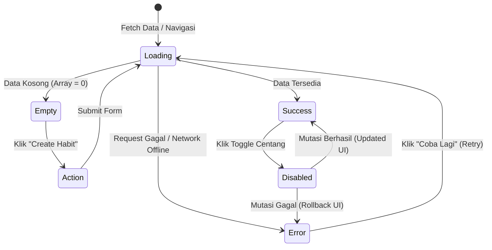

# UI/UX DESIGN SYSTEM & INTERACTION GUIDE — HABIT TRACKER

**Dokumen Referensi Utama**: [PRD and Playbook.md](./PRD%20and%20Playbook.md) & [TECHNICAL_PLAN.md](./TECHNICAL_PLAN.md)  
**Versi**: 1.0.0  
**Status**: Approved (Phase 3 Deliverable)  
**Tanggal**: 2026-11-03  
**Penulis**: Senior UI/UX Designer & Frontend Architect  

---

## 1. Design Philosophy & Visual Direction

Habit Tracker dirancang dengan filosofi **"Calm, Focused, and Action-Oriented"**. Membangun kebiasaan positif memerlukan konsistensi mental yang bebas dari distraksi visual dan kelelahan informasi (*cognitive overload*). 

### 1.1 Prinsip Desain Utama:
1. **Calm & Distraction-Free**: Menggunakan latar belakang netral yang bersih, tipografi yang jernih, dan kontras yang proporsional. Hindari elemen gamifikasi berlebihan yang melelahkan (tidak ada animasi pop-up confetti yang agresif atau suara berisik).
2. **Prioritas Aksi Harian (Action-First)**: Tugas utama pengguna saat membuka aplikasi adalah menandai kebiasaan hari ini. Seluruh alur visual mengarahkan fokus ke habit hari ini (*Today's Habits*) dan progres harian.
3. **Subtle & Meaningful Color Accents**: Warna aksen hanya digunakan untuk memberikan status yang jelas (selesai, tertunda, streak aktif) dan membedakan kategori habit.
4. **Respon Cepat & Aksesibel**: Setiap interaksi centang memberikan konfirmasi visual instan (*optimistic UI*), mendukung navigasi keyboard penuh, dan mematuhi standar aksesibilitas WCAG 2.1 AA.
5. **Mobile-Native Feel**: Antarmuka dioptimalkan untuk perangkat genggam (layar sentuh) dengan *touch target* minimal 44x44px dan navigasi bawah (*bottom bar*) yang mudah dijangkau satu tangan.

---

## 2. Design Tokens & Styling Architecture

Design tokens diselaraskan secara natif dengan **Tailwind CSS v4** dan variabel CSS **shadcn/ui**.

### 2.1 Color Palette & Theme Tokens

Palet warna menggunakan variabel CSS HSL/RGB untuk mendukung tema terang (*Light Mode*) dan gelap (*Dark Mode*):

| Token Name | Light Theme Value | Dark Theme Value | Penggunaan / Peran |
| :--- | :--- | :--- | :--- |
| `--background` | `hsl(0, 0%, 100%)` (#FFFFFF) | `hsl(224, 71%, 4%)` (#020817) | Latar belakang utama aplikasi |
| `--foreground` | `hsl(222.2, 84%, 4.9%)` (#020817) | `hsl(210, 40%, 98%)` (#F8FAFC) | Teks primer / heading |
| `--card` | `hsl(0, 0%, 100%)` (#FFFFFF) | `hsl(222.2, 84%, 4.9%)` (#020817) | Latar belakang kartu habit & statistik |
| `--card-foreground`| `hsl(222.2, 84%, 4.9%)` (#020817) | `hsl(210, 40%, 98%)` (#F8FAFC) | Teks isi kartu |
| `--primary` | `hsl(221.2, 83.2%, 53.3%)` (#2563EB)| `hsl(217.2, 91.2%, 59.8%)` (#3B82F6)| Warna utama (Tombol primer, active state) |
| `--primary-foreground`| `hsl(210, 40%, 98%)` (#FFFFFF) | `hsl(222.2, 47.4%, 11.2%)` (#0F172A)| Teks di atas warna primary |
| `--secondary` | `hsl(210, 40%, 96.1%)` (#F1F5F9) | `hsl(217.2, 32.6%, 17.5%)` (#1E293B)| Tombol sekunder, filter pills |
| `--muted` | `hsl(210, 40%, 96.1%)` (#F1F5F9) | `hsl(217.2, 32.6%, 17.5%)` (#1E293B)| Latar belakang elemen non-aktif |
| `--muted-foreground` | `hsl(215.4, 16.3%, 46.9%)` (#64748B)| `hsl(215, 20.2%, 65.1%)` (#94A3B8)| Teks sekunder, deskripsi, timestamp |
| `--border` | `hsl(214.3, 31.8%, 91.4%)` (#E2E8F0)| `hsl(217.2, 32.6%, 17.5%)` (#1E293B)| Garis batas kartu, pemisah, input |
| `--input` | `hsl(214.3, 31.8%, 91.4%)` (#E2E8F0)| `hsl(217.2, 32.6%, 17.5%)` (#1E293B)| Garis batas form input |
| `--ring` | `hsl(221.2, 83.2%, 53.3%)` (#2563EB)| `hsl(224.3, 76.3%, 48%)` (#1D4ED8)| Focus ring outline untuk aksesibilitas |
| `--success` | `hsl(142.1, 76.2%, 36.3%)` (#16A34A)| `hsl(142.1, 70.6%, 45.3%)` (#22C55E)| Status habit selesai, progress 100% |
| `--destructive` | `hsl(0, 84.2%, 60.2%)` (#EF4444) | `hsl(0, 62.8%, 30.6%)` (#7F1D1D)| Aksi hapus habit, validasi error |

#### Palet Warna Aksen Habit Preset:
Pengguna dapat memilih warna aksen personal untuk setiap habit:
- **Emerald** (Kesehatan/Olahraga): `#10B981`
- **Blue** (Belajar/Fokus): `#3B82F6`
- **Violet** (Kreativitas/Menulis): `#8B5CF6`
- **Amber** (Produktivitas/Rutin): `#F59E0B`
- **Rose** (Mindfulness/Meditasi): `#F43F5E`
- **Cyan** (Hidrasi/Kebugaran): `#06B6D4`

---

### 2.2 Typography System

Menggunakan font keluarga modern sans-serif sans overhead font eksternal: **Geist Sans** atau **Inter** dengan fallback ke `system-ui`.

| Scale | Tailwind Class | Font Size | Line Height | Weight | Penggunaan |
| :--- | :--- | :--- | :--- | :--- | :--- |
| **H1** | `text-2xl sm:text-3xl` | 24px / 30px | 32px / 36px | Bold (700) | Judul Halaman Utama (Dashboard, Habits) |
| **H2** | `text-xl sm:text-2xl` | 20px / 24px | 28px / 32px | SemiBold (600) | Judul Sub-bagian, Header Kartu Ringkasan |
| **H3** | `text-lg sm:text-xl` | 18px / 20px | 26px / 28px | SemiBold (600) | Judul Habit di HabitCard, Judul Modal |
| **Body Large**| `text-base` | 16px | 24px | Regular (400) | Teks utama, input form, tombol utama |
| **Body Small**| `text-sm` | 14px | 20px | Regular (400) | Deskripsi habit, label form, keterangan navigasi |
| **Caption** | `text-xs` | 12px | 16px | Medium (500) | Badge streak, tanggal, hint form, microcopy |

---

### 2.3 Spacing & Layout Grid (4px Base Scale)

- **Grid Dasar**: Kelipatan 4px (`p-1` = 4px, `p-2` = 8px, `p-3` = 12px, `p-4` = 16px, `p-6` = 24px, `p-8` = 32px).
- **Container Max-Width**: `max-w-7xl mx-auto` untuk halaman dashboard, `max-w-md mx-auto` untuk halaman form autentikasi (Login/Register).
- **Content Padding**:
  - Mobile: `px-4 py-6`
  - Tablet/Desktop: `px-8 py-8`
- **Gap Antar Kartu**: `gap-4 sm:gap-6`

---

### 2.4 Border Radius & Elevation Tokens

- **Radius**:
  - `rounded-sm`: 4px (Tag/Badge kecil)
  - `rounded-md`: 6px (Input form, tombol sekunder)
  - `rounded-lg`: 8px (Tombol utama, dialog modal)
  - `rounded-xl`: 12px (Kartu habit, widget ringkasan statistik)
  - `rounded-full`: 9999px (Checkbox bulat/pill hari, avatar)
- **Borders & Shadows**:
  - `border border-border`: Garis batas halus 1px untuk memisahkan konten tanpa kontras tajam.
  - `shadow-sm`: Bayangan sangat tipis untuk kartu diam (`hover:shadow-md transition-shadow duration-200`).

---

## 3. Responsive Layout Specifications

Aplikasi memiliki dua mode penyajian layout: **Desktop Layar Lebar ($\ge 1024\text{px}$)** dan **Mobile Layar Sempit ($< 768\text{px}$)**, dengan breakpoint tablet ($768\text{px} - 1023\text{px}$) yang adaptif.

### 3.1 Desktop Layout Wireframe ($\ge 1024\text{px}$)

```text
+------------------------------------------------------------------------------------+
|  [Logo] HabitTracker      | [Header] Tuesday, Nov 3, 2026        [User Avatar (v)] |
+---------------------------+--------------------------------------------------------+
| [Sidebar Navigation]      | [Main Content Area] (max-w-7xl)                        |
|                           |                                                        |
|  * Dashboard  (Active)    |  +--------------------------------------------------+  |
|  * Habits                 |  | Daily Progress Banner: 4 of 6 Habits Completed   |  |
|  * Statistics             |  | [============ 67% ============---------]         |  |
|  * Settings               |  +--------------------------------------------------+  |
|                           |                                                        |
|                           |  Today's Habits                      [+ Create Habit]  |
|                           |  +---------------------+  +---------------------+      |
|                           |  | [x] Morning Workout |  | [ ] Read 20 Pages   |      |
|                           |  | 5 days streak [Fire]|  | 12 days streak[Fire]|      |
|                           |  +---------------------+  +---------------------+      |
|                           |  +---------------------+  +---------------------+      |
|                           |  | [x] Drink 2L Water  |  | [x] Meditation      |      |
|                           |  | 3 days streak [Fire]|  | 8 days streak [Fire]|      |
|                           |  +---------------------+  +---------------------+      |
|                           |                                                        |
|  [v] v1.0.0               |  Weekly Consistency Heatmap                            |
|  [Logout Button]          |  [Mon] [Tue] [Wed] [Thu] [Fri] [Sat] [Sun]             |
+---------------------------+--------------------------------------------------------+
```

### 3.2 Mobile Layout Wireframe ($< 768\text{px}$)

```text
+-------------------------------------------------+
| [Logo] HabitTracker           [User Avatar (v)] |
| Tuesday, Nov 3                                  |
+-------------------------------------------------+
| [Scrollable Content Area]                       |
|                                                 |
| +---------------------------------------------+ |
| | Today's Progress                     67%    | |
| | 4 of 6 completed                            | |
| | [============== 67% ============----------] | |
| +---------------------------------------------+ |
|                                                 |
| Today's Habits                 [+ New]          |
|                                                 |
| +---------------------------------------------+ |
| | [x] Morning Workout                         | |
| | Health & Fitness • 5 day streak [Fire]      | |
| +---------------------------------------------+ |
| | [ ] Read 20 Pages                           | |
| | Learning • 12 day streak [Fire]             | |
| +---------------------------------------------+ |
| | [x] Drink 2L Water                          | |
| | Health & Fitness • 3 day streak [Fire]      | |
| +---------------------------------------------+ |
|                                                 |
+-------------------------------------------------+
| [Bottom Navigation Bar - Fixed]                 |
|  [Home]       [Habits]       [Stats]  [Settings]|
+-------------------------------------------------+
```

---

## 4. Reusable Component Specifications

### 4.1 `AppShell`
- **Deskripsi**: Komponen pembungkus terluar layout yang mengatur rendering responsif.
- **Perilaku**:
  - Pada desktop: Merender `<Sidebar />` permanen di sisi kiri (lebar `w-64`) dan `<Header />` di bagian atas.
  - Pada mobile: Menyembunyikan sidebar, merender top bar yang ringkas, serta menampilkan `<MobileNavigation />` yang menempel di bagian bawah layar (`fixed bottom-0`).

### 4.2 `HabitCard`
- **Deskripsi**: Kartu representasi sebuah habit pada daftar hari ini atau manajemen habit.
- **Elemen Penyusun**:
  1. **Aksen Warna**: Garis vertikal 4px di sisi kiri kartu sesuai dengan warna habit (`habit.color`).
  2. **Indikator Centang**: Tombol checkbox bulat berdiameter 28px dengan transisi checkmark halus.
  3. **Judul & Frekuensi**: Judul habit (`text-base font-semibold`) dan badge frekuensi (`Daily` atau `Mon, Wed, Fri`).
  4. **Streak Badge**: Badge kecil di samping nama dengan ikon api dan jumlah hari (`🔥 7`).
  5. **Menu Aksi (Tiga Titik)**: Dropdown untuk *Edit*, *Archive*, dan *Delete*.
- **Interaksi**:
  - Klik pada area checkbox: Memicu mutasi toggle completion secara instan (*optimistic*).
  - Saat `completed`: Teks judul mendapatkan efek *subtle strike-through* atau warna teks memudar ke `muted-foreground`, background kartu berubah sedikit lebih tenang.

### 4.3 `ProgressBar` & `DailyProgressCard`
- **Deskripsi**: Visualisasi ringkasan pencapaian harian.
- **Elemen Penyusun**:
  - Judul: "Today's Progress".
  - Rasio Teks: "4 of 6 completed" dan persentase numerik "67%".
  - Batang Progres: Container `h-3 rounded-full bg-muted` dengan bar bagian dalam `bg-primary` (atau `bg-success` saat 100%) dengan animasi transisi lebar `transition-all duration-500 ease-out`.

### 4.4 `StatCard`
- **Deskripsi**: Kartu metrik ringkas untuk halaman statistik.
- **Varian**:
  - *Current Streak*: Menampilkan streak aktif tertinggi saat ini.
  - *Best Streak*: Rekor streak terpanjang sepanjang masa.
  - *Completion Rate*: Persentase keberhasilan 30 hari terakhir.
  - *Total Completions*: Akumulasi jumlah centang selesai.

### 4.5 `HabitForm`
- **Deskripsi**: Form terstandarisasi untuk modal/halaman tambah dan edit habit.
- **Field & Validasi Visual**:
  - **Nama Habit**: Input teks dengan batas maksimal 100 karakter dan *character counter*.
  - **Deskripsi**: Textarea opsional (maksimal 500 karakter).
  - **Frekuensi**: Pilihan toggle button `Daily` atau `Weekly`.
  - **Pilihan Hari (Scheduled Days)**: 7 pill interaktif (M, T, W, T, F, S, S). Otomatis terpilih semua jika memilih `Daily`. Pengguna dapat memilih kombinasi hari jika memilih `Weekly`.
  - **Pilihan Warna**: 6 preset palet warna lingkaran (Emerald, Blue, Violet, Amber, Rose, Cyan) dengan indikator aktif ring.

---

## 5. UI States Matrix

Setiap komponen yang menampilkan data asynchronous wajib menangani 6 status antarmuka:



### 5.1 Rincian State dan Panduan Implementasi:

| UI State | Indikator Visual | Interaksi Pengguna | Komponen Terkait |
| :--- | :--- | :--- | :--- |
| **Loading** | `Skeleton` card beranimasi *pulse* abu-abu halus sesuai bentuk habit card asli. | Tombol input dinonaktifkan untuk mencegah klik prematur. | `HabitCardSkeleton`, `DashboardSkeleton` |
| **Empty** | Ikon ilustrasi tenang (misal: kalender kosong atau target panah), judul jelas ("Belum ada habit"), pesan edukatif singkat, dan tombol CTA primer. | Tombol utama "+ Tambah Habit Baru" membuka form pendaftaran kebiasaan. | `EmptyState` |
| **Error** | Banner peringatan halus merah lembut (`bg-destructive/10 text-destructive border-destructive/20`), pesan error spesifik, dan tombol "Coba Lagi". | Pengguna dapat mengklik tombol "Coba Lagi" tanpa perlu me-reload seluruh halaman. | `ErrorAlert`, `FormErrorMessage` |
| **Success** | Checkmark terisi dengan transisi lembut, progress bar bertambah seketika, toast notification singkat di sudut layar jika diperlukan. | Checkbox dapat diklik kembali untuk membatalkan (*uncheck*). | `HabitCheckbox`, `Toast` |
| **Disabled** | Opacity elemen berkurang ke `opacity-50`, cursor berubah menjadi `not-allowed`. | Mencegah *double-click* atau *rapid-firing* request saat mutasi sedang berlangsung. | `Button`, `Checkbox` |
| **Completed** | Checkbox berwarna hijau/primary tercentang, badge streak bersinar lembut, teks judul berubah tenang. | Memberikan rasa kepuasan (*micro-reward*) tanpa animasi berlebihan. | `HabitCard` |

---

## 6. Accessibility (a11y) & Usability Standards

1. **Standar Kontras Warna (WCAG AA)**: Seluruh teks memiliki rasio kontras minimal $4.5:1$ terhadap background-nya ($3:1$ untuk teks besar $\ge 18\text{px}$).
2. **Navigasi Keyboard**:
   - `Tab` dan `Shift + Tab` dapat mengakses seluruh elemen interaktif secara logis dari atas ke bawah.
   - `Space` atau `Enter` dapat digunakan untuk menandai atau membatalkan habit pada tombol checkbox.
   - `Escape` otomatis menutup modal dialog konfirmasi atau form penambahan habit.
   - Focus outline terlihat jelas melalui token `--ring` (`focus-visible:ring-2 focus-visible:ring-offset-2`).
3. **Screen Reader Optimization**:
   - Checkbox habit memiliki `role="checkbox"`, `aria-checked="true|false"`, dan `aria-label="Tandai [Nama Habit] selesai untuk hari ini"`.
   - Perubahan nilai progress bar dilengkapi dengan `aria-valuenow`, `aria-valuemin="0"`, dan `aria-valuemax="100"`.
   - Pesan error pada form terhubung dengan input melalui `aria-describedby="field-error-id"`.
4. **Mobile Touch Ergonomics**:
   - Seluruh elemen yang dapat diklik memiliki area sentuh minimal $44 \times 44\text{px}$ (meskipun ikon visualnya berukuran 24px, padding transparan diperluas).
   - Penempatan tombol navigasi esensial di bagian bawah mempermudah akses ibu jari (*thumb zone*).

---

## 7. Acceptance Criteria Verification for Phase 3

- [x] **Design Direction Jelas**: Filosofi minimalis, tenang, bebas distraksi, dan terfokus pada aksi harian terdokumentasi.
- [x] **Layout Desktop Tersedia**: Struktur sidebar, top header, daily progress banner, dan habit grid terdefinisi lengkap dengan diagram wireframe ASCII.
- [x] **Layout Mobile Tersedia**: Struktur compact header, scrollable cards, dan fixed bottom navigation terdefinisi lengkap dengan diagram wireframe ASCII.
- [x] **Design Tokens Terdokumentasi**: Palet warna lengkap (Light & Dark mode), font scale, spacing scale, border radius, dan aksen habit terdokumentasi.
- [x] **Komponen Reusable Terdefinisi**: `AppShell`, `HabitCard`, `ProgressBar`, `StatCard`, `HabitForm`, `ConfirmDialog`, `EmptyState`, dan `Skeleton` telah ditentukan spesifikasinya.
- [x] **UI States Terdokumentasi**: Matriks 6 status visual (*Loading*, *Empty*, *Error*, *Success*, *Disabled*, *Completed*) beserta diagram alur state telah ditetapkan.

